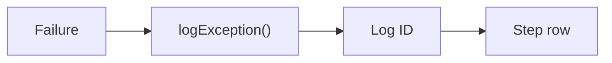

# Error handling and log IDs

The assertion exception does not implement exface `ExceptionInterface`.
`ErrorManager::logException($exception, $workbench)` wraps the failure in the exface
`RuntimeException` and returns `?string`: a persisted log ID after a successful write,
or null without a workbench. A workbench-less call leaves the last ID unchanged.
Logger failures propagate without storing a new ID.

Successfully logged throwable objects are remembered in a WeakMap. Logging the same object
again reuses its ID without another monitor write, including a substep failure rethrown into
the AfterStep hook. Different objects are tracked separately.

The AfterStep hook collects the returned ID and prints it only when non-empty. If logging
fails, it still collects the original message with the logger failure message and a null
`logId`. Hook failures must not terminate Behat.

Substeps set their own ID, including null after a logging failure, and restore it after all
failure handling before dispatching the completed event. `DatabaseFormatter` uses the last
ID for the failed step's `error_log_id`. This remains shared process state: formatter database
failures can still overwrite it; moving IDs onto result objects is separate work.

`ErrorManager::logWarning()` handles detector housekeeping and screenshot failures without
changing the last ID. It falls back to STDERR if the warning logger fails. The browser creates
one detector shared with its wait manager. Report-finalization failures go directly to STDERR
because central logging is unsafe during destruction.

Both error text formatters share one optional log-reference line.
`ErrorManager::buildErrorLine()` builds a single-line markdown error and includes a Log-ID
suffix only when a persisted ID is supplied; this does not introduce per-step report logbooks.