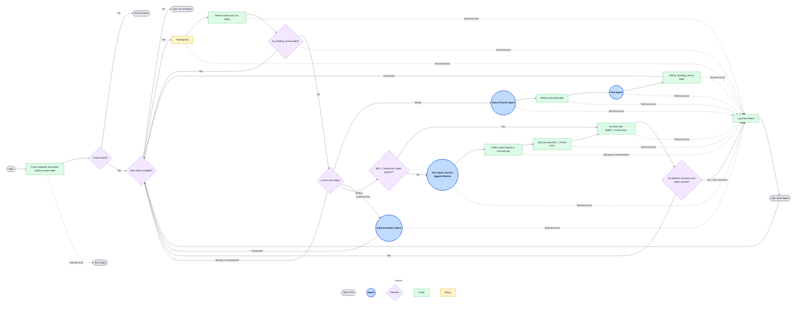

<!-- Generated by GitHub Copilot - Nov-09-2026 -->
# Jira implementation workflow

The action `axenox.BDT.RunImplementationWorkflow` adapts the supplied pilot
workflow to BDT. It reads tickets assigned to the Jira connection user, excludes
`AI_awaiting_review`, refreshes each ticket, and processes tickets sequentially:

- **Ready:** Story Planner Agent, refresh persisted plan, Test Agent, add
  `AI_awaiting_review`. No browser execution.
- **Implementing:** Implementation Agent. No browser execution.
- **Testing:** Look for the exact Jira label `BDT_<Ticket-Key>`.
  - Label exists: execute `axenox.BDT.RunTest` directly with the tag
    `@BDT_<Ticket-Key>`. No agent invocation.
  - Label absent: ask the Test Agent to create/update and persist tagged
    Gherkin, verify a parsed feature/scenario with this tag exists in an
    installed app's `Tests` directory, add the Jira label, then execute RunTest.

For example, Jira issue `DEMO-123` uses label `BDT_DEMO-123` and Gherkin tag
`@BDT_DEMO-123`. The Jira status is **not** changed. Labels are added atomically;
other Jira labels are preserved. A failed test leaves the feature association
in place, so the next run tests the same tag rather than regenerating tests.
Tickets with missing/unexpected statuses or the review label are skipped.

## Configuration and prerequisites

This is an optional integration: the installation must provide GenAI (including
the workflow run/step model), the
`axenox.AtlassianConnector.JIRA_ISSUE` metamodel object, and an authenticated Jira
HTTP connection. Label operations use this connection directly; no separate
`JiraIssueLabelClient` class is required. The connection's API base URL must
support relative `search/jql` and `issue/<key>` endpoints.

Configure the action where the autonomous workflow is invoked:

```json
{
  "alias": "axenox.BDT.RunImplementationWorkflow",
  "jira_connection_alias": "<installation Jira connection alias>",
  "story_planner_agent_alias": "<Story Planner Agent alias>",
  "test_agent_alias": "<Test Agent alias>",
  "implementation_agent_alias": "<Implementation Agent alias>",
  "ready_status": "Ready",
  "implementing_status": "Implementing",
  "testing_status": "Testing",
  "ticket_limit": 100
}
```

`autonomous_agent_alias` optionally links the run to an existing autonomous
agent configuration. Status names are configurable and matched without case or
surrounding whitespace. The ticket limit is between 1 and 100; one Jira search
page is processed per invocation, as in the supplied pilot.

The Test Agent needs feature authoring, reading and validation tools (for
example the `GherkinReadWrite` skill). In the Testing branch it must persist
tests on the same filesystem used by BDT. It is instructed not to run tests or
change Jira labels/status: the workflow owns those operations. A response
claiming a feature was created is insufficient without a real tagged feature.

RunTest uses the installation's existing Behat/Chrome configuration. Only the
literal ticket tag is passed; no ticket-controlled command, executable,
configuration path, or tag expression is accepted. Ensure the intended app's
features are included in Behat's configured suites. The tag selects all matching
scenarios in those suites, including scenario outlines.

Use an authorized test installation, not production: tests may create users or
modify data. No credentials or installation-specific connection IDs are
included in the action or example. No scheduler or autonomous agent is
automatically installed or enabled.

## Results and errors

The workflow consumes RunTest's deferred output before marking its step
complete. RunTest currently exposes results as text, so the workflow requires
its success banner and positive English Behat scenario **and** step summaries
in which every selected item passed. Failed, skipped, pending or undefined
steps, crashes, missing summaries and zero scenarios are failures. If a custom
formatter removes/translates the summaries, verification fails explicitly
rather than assuming success.

Each ticket failure is logged and marked failed; remaining tickets continue.
The run returns processed/skipped/failed counts, with `partially_failed` and a
failed run status when any ticket failed. A worklist failure terminates the run.
Testing tickets remain eligible for a subsequent scheduled run; passing tests
do not automatically mark review, transition, or unassign tickets.

## Focused automated checks

From the BDT package directory, using the installation's existing PHPUnit:

```console
php ..\..\bin\phpunit --no-configuration --bootstrap Tests\PHPUnit\bootstrap.php --do-not-cache-result Tests\PHPUnit\RunImplementationWorkflowTest.php
```

These tests do not contact Jira, invoke an LLM, or launch Chrome. They cover
routing, generation/association order, actual Gherkin tag parsing, literal tag
scope, deferred execution and failed/empty test selections.

## Workflow diagram


